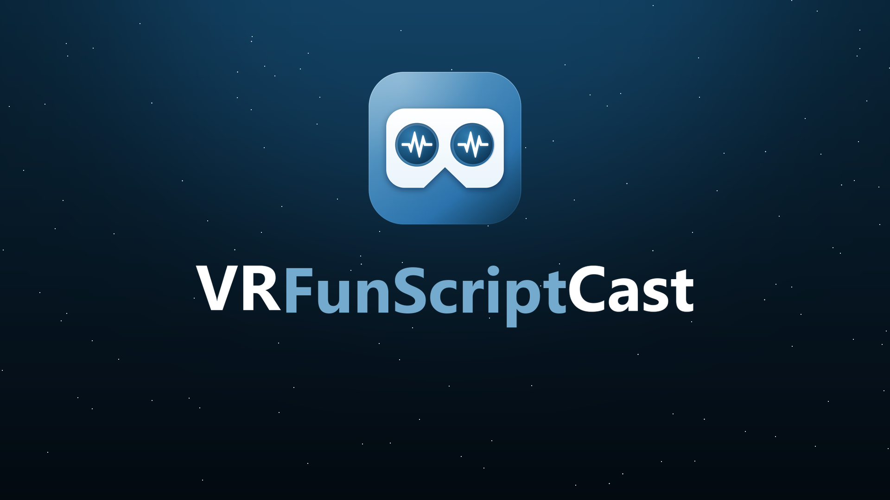
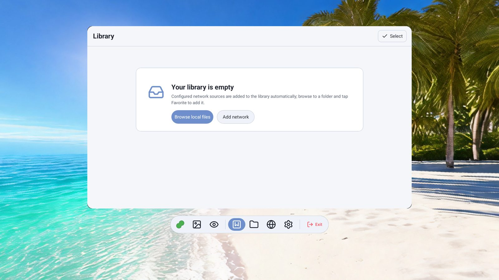
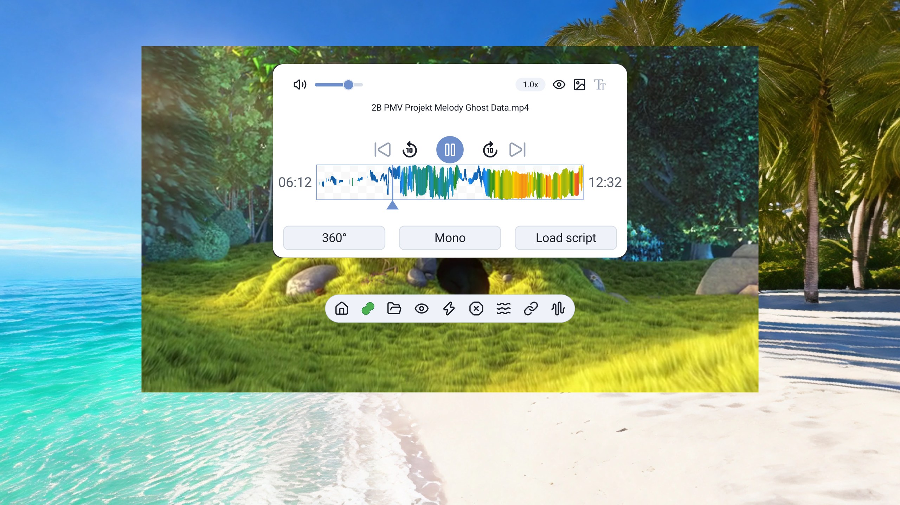
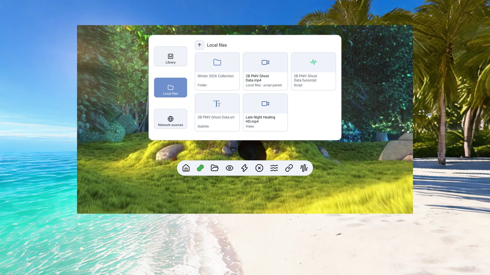
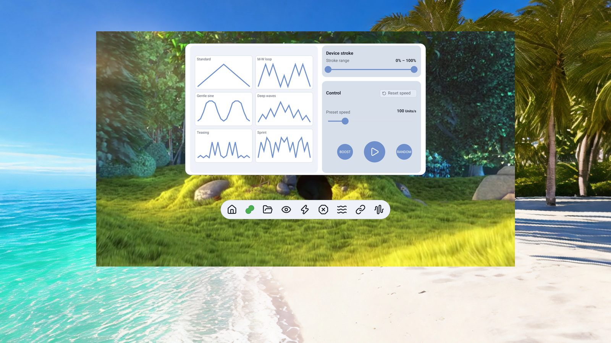
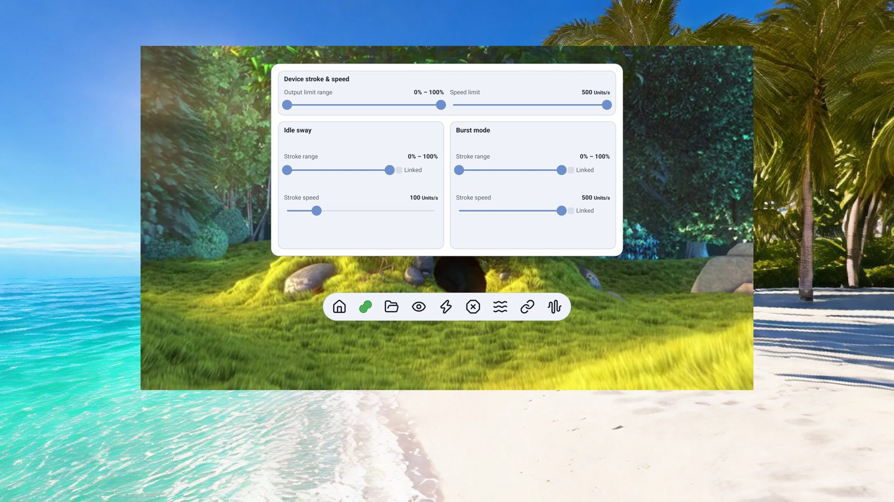
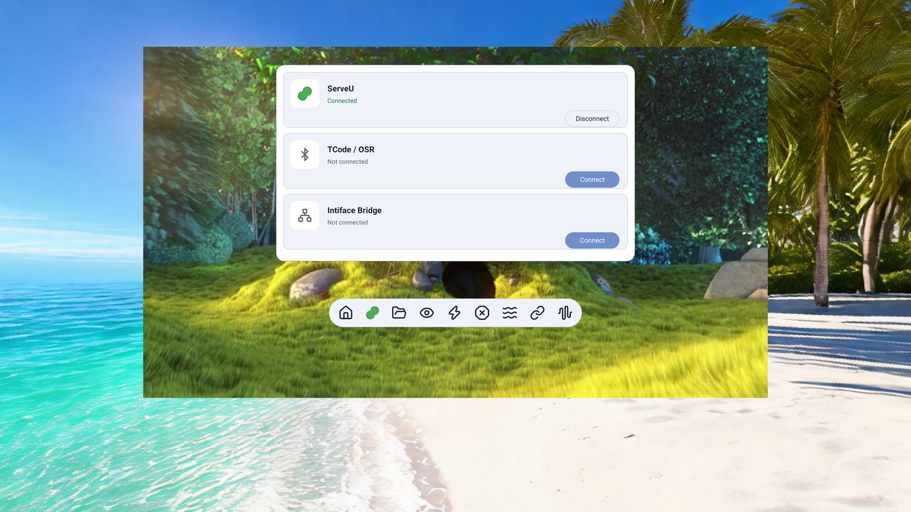
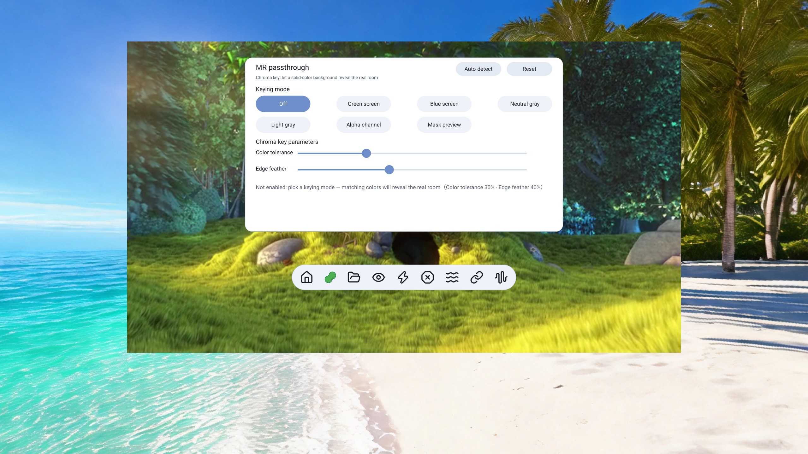

    

[中文](README.md) | English

Native OpenXR VR video player for Android (Quest / PICO)

 

 

 

 

## Supported platforms

- [x] Meta Quest 3 (Android 14, verified)
- [x] PICO 4 family (runs on real hardware; device / OS differences exist — include your device model and logs when reporting issues)
- [x] Single `arm64-v8a` APK, no separate Quest / Pico builds

## Features

- [x] Playback & picture
  - [x] Projection formats: flat / equirectangular 180° / equirectangular 360° / fisheye 180° / fisheye 190° / lens-outline 200° / 220°, switchable during playback
  - [x] Stereo layouts: top-bottom / half-width SBS / full-width SBS / mono
  - [x] VR zoom: angular re-mapping, no distortion while grabbed
  - [x] Speed presets 1.0× / 1.25× / 1.5× / 2.0×, continuous playback, previous / next episode, retry on failure
  - [x] Funscript action heatmap on the seek bar
- [x] Video passthrough (MR)
  - [x] Green / blue / neutral-gray / light-gray chroma key + alpha channel + mask preview
  - [x] Auto-detects the dominant color of the current frame; survives video change / restart
- [x] Scenes & passthrough
  - [x] 8 built-in virtual scenes, one tap to switch to real-environment passthrough
- [x] Network sources & library
  - [x] SMB / WebDAV / DLNA direct LAN streaming, no copying needed
  - [x] Library shortcuts, per-folder scroll memory, three-source state sync
  - [x] External subtitles `.srt` / `.ass` / `.ssa` auto-loaded by same name
- [x] FunScript sync
  - [x] Script auto-matching (same-name file → local script folder → remote script folder) + manual pick
  - [x] 24 waveform presets + RANDOM shuffle + BOOST; stroke range / speed sliders in real time
  - [x] One-tap emergency stop / boost / idle easing / linkage control
- [x] Device linking (requires a license)
  - [x] BLE toys over Bluetooth
  - [x] TCode / OSR Bluetooth SPP direct (OSR2 / SR6 / SSR1 and more; v0.2 / v0.3 selectable)
  - [x] Intiface Central bridge (Buttplug, hundreds of devices)
  - [x] Stroke range / speed limit / invert / OC mode, device info, Wi-Fi firmware OTA
- [x] VR interaction
  - [x] Laser pointer with dot highlight, trigger to click, B / X to go back
  - [x] Thumbstick flick for ±10s seek, hold to fast seek; thumbstick up/down for zoom
  - [x] Hold grip to drag — move / rotate the playback window freely

 

## Download

Get it from [Releases](https://github.com/wanfneg/VRFunScriptCast-Releases/releases/latest) or install from [SideQuest](https://sidequestvr.com/app/63810).
Single `arm64` APK; same-signature builds upgrade in place.

See the **[User Guide](docs/user-guide.en.md)** for details (known limitations / features / install / quick start / FAQ).

 

## Sponsor & License

Playback, file browsing, network sources — **everything is free, forever**.
Only **device linking** (BLE / TCode / Intiface) needs a one-time license: **lifetime, one code per headset, no subscription**.

| Region | Platform | Payment | Price | Link |
|---|---|---|---|---|
| Mainland China | Afdian | Alipay / WeChat | ¥30 | https://afdian.com/item/92b5f30edd1c11f1ad7d52540025c377 |
| Everywhere else | Ko-fi | PayPal / card | $9.99 | https://ko-fi.com/s/4bcd6114c5 |

**How to activate**: in-headset Settings → Activation → paste your order ID → tap Claim.
After changing devices or factory-resetting your headset, send your order ID to get it re-bound.

**ServeU (抚物) device owners**: activation is **free** — power on the device, keep it near the headset and tap "Activate via device" in Settings → Activation. It verifies automatically, no order ID needed. QQ `2831691505` remains a fallback contact.

 

## Disclaimer

This project is developed by an individual out of personal interest. It does not provide, index, or contain any pirated or cracked content.
Do not resell the APK; credit the source when re-sharing.

Thanks for using it

 

## Acknowledgements

- [Khronos OpenXR-SDK](https://github.com/KhronosGroup/OpenXR-SDK) (Apache-2.0)
- [Media3 / ExoPlayer](https://github.com/androidx/media)
- Kotlin / Jetpack Compose
- etc.

 
 
 

## Star History

<a href="https://star-history.com/#wanfneg/VRFunScriptCast-Releases&Date">
 <picture>
   <source media="(prefers-color-scheme: dark)" srcset="https://api.star-history.com/svg?repos=wanfneg/VRFunScriptCast-Releases&type=Date&theme=dark" />
   <source media="(prefers-color-scheme: light)" srcset="https://api.star-history.com/svg?repos=wanfneg/VRFunScriptCast-Releases&type=Date" />
   
 </picture>
</a>
