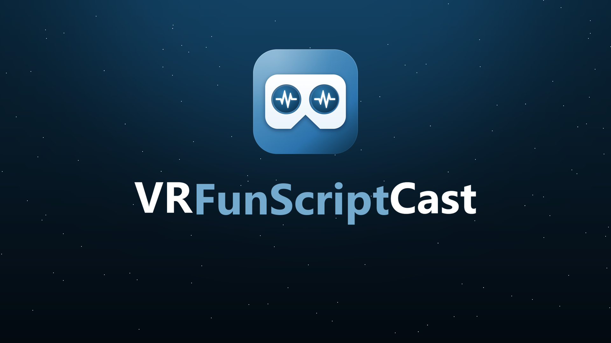
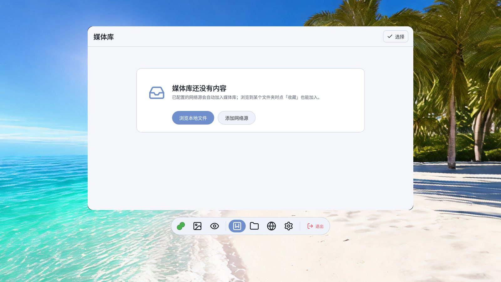
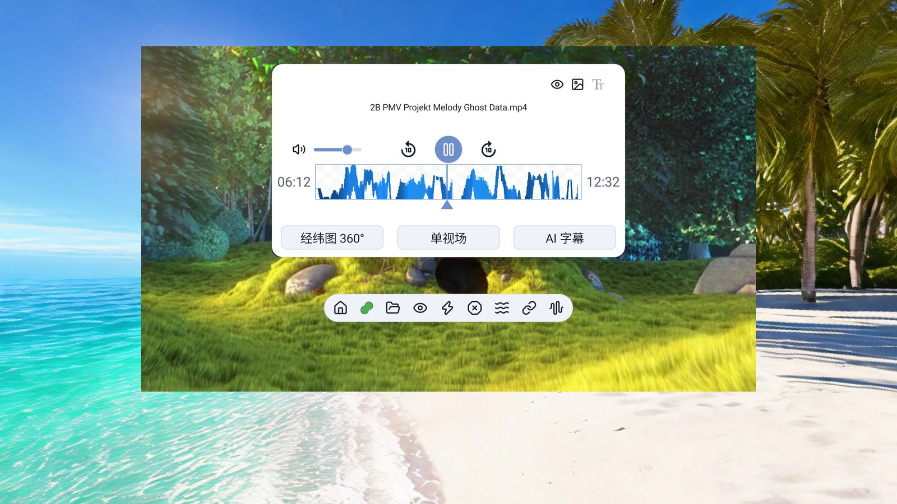
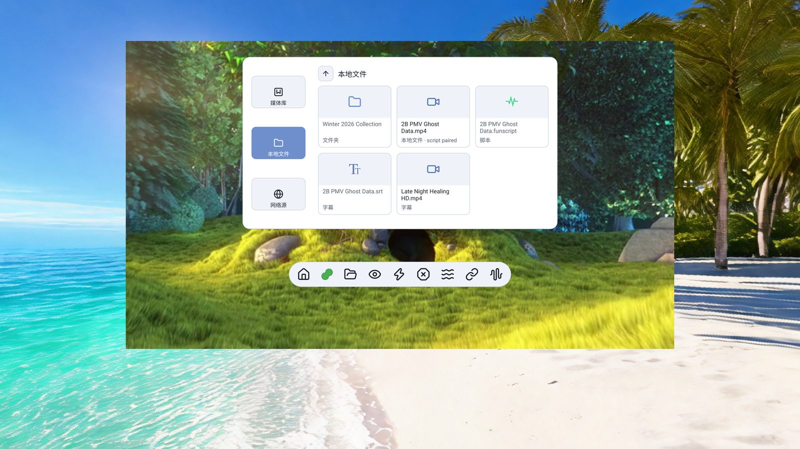
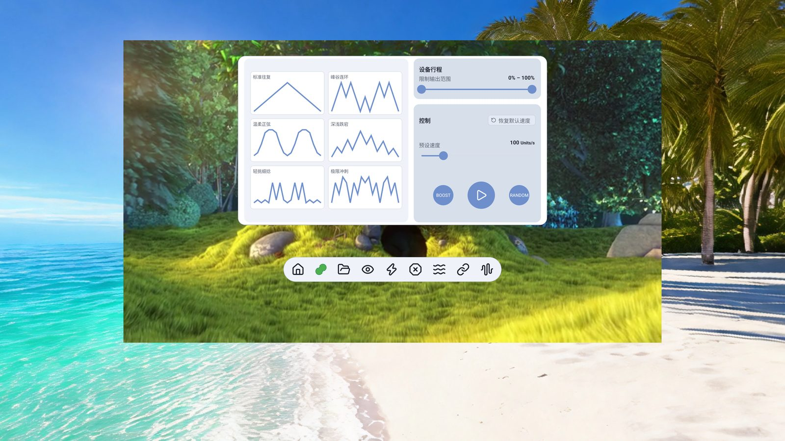
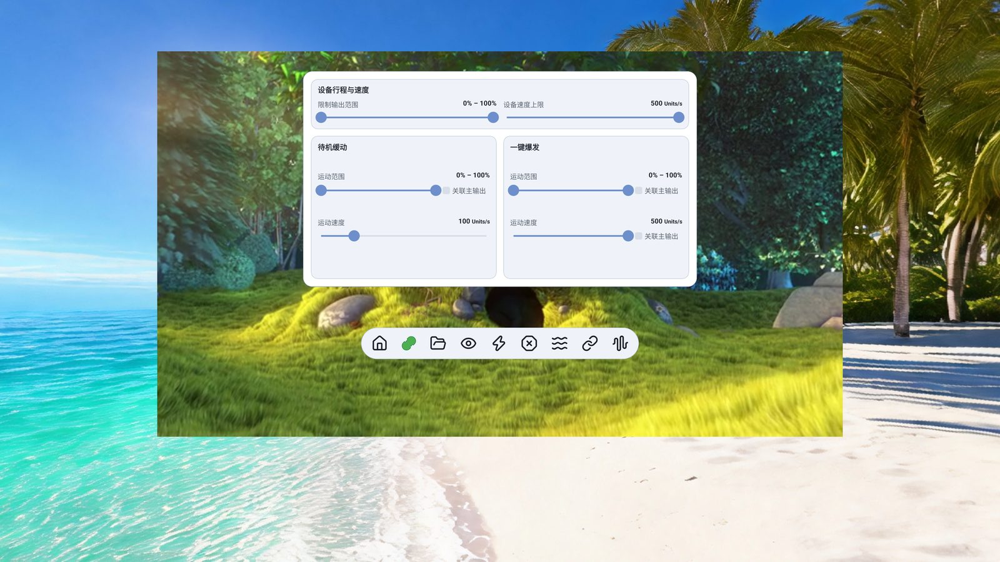
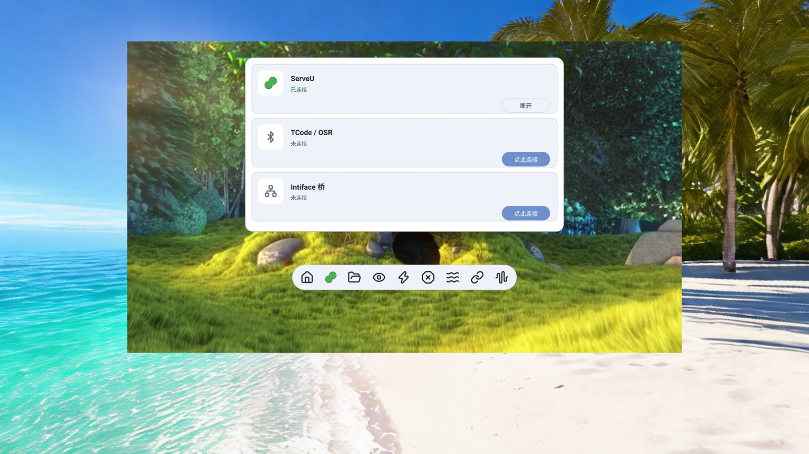
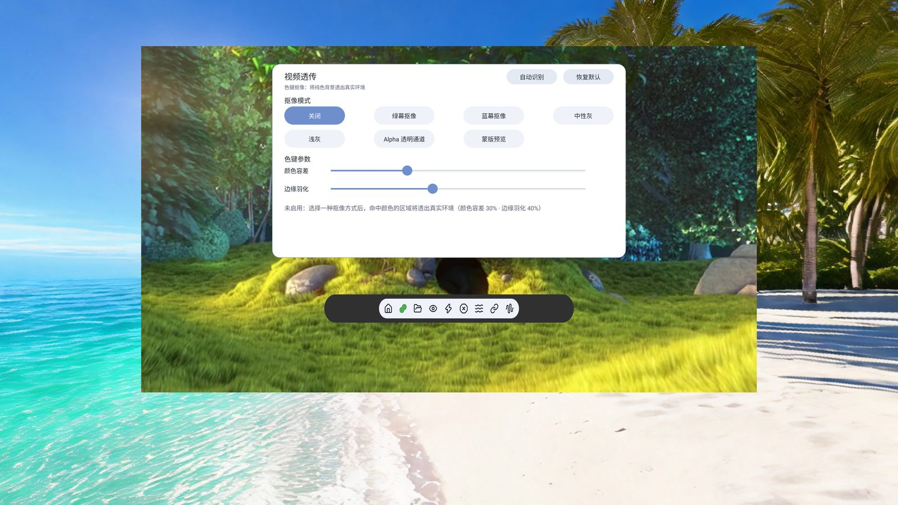

    

中文 | [English](README.en.md)

Android + OpenXR 原生 VR 视频播放器（Quest / PICO）

 

 

 

 

## 适配平台

- [x] Meta Quest 3（Android 14，已验收）
- [x] PICO 4 系列（已实机运行；机型 / 系统版本差异较大，遇异常请附机型与日志反馈）
- [x] arm64-v8a 单包，不分 Quest / Pico

## 功能

- [x] 视频播放与画面
  - [x] 投影格式：平面 / 经纬 180° / 经纬 360° / 鱼眼 180° / 鱼眼 190° / 镜头轮廓 200° / 220°，播放中随时切换
  - [x] 立体格式：上下 / 左右半宽 / 左右全宽 / 单视场
  - [x] VR 视角缩放：角向双射，抓握缩放不畸变
  - [x] 倍速四档 1.0× / 1.25× / 1.5× / 2.0×，连播、上 / 下一集、失败重试
  - [x] 进度条以 funscript 动作热力图呈现
- [x] 视频透传（MR）
  - [x] 绿 / 蓝 / 中性灰 / 浅灰色键抠像 + Alpha 透明通道 + 蒙版预览
  - [x] 自动识别当前帧主色，换片 / 重启不丢
- [x] 场景与透视
  - [x] 8 个内置虚拟场景，一键切换头显真实环境透视
- [x] 网络源与媒体库
  - [x] SMB / WebDAV / DLNA 局域网直连，无需拷贝
  - [x] 媒体库快捷收藏、浏览位置自动记忆、三来源状态同步
  - [x] 外挂字幕 `.srt` / `.ass` / `.ssa` 同目录同名自动加载
- [x] FunScript 同步
  - [x] 脚本自动匹配（同目录同名 → 本地脚本文件夹 → 远程脚本文件夹）+ 手动点选
  - [x] 24 种波形预设 + RANDOM 循环随机 + BOOST 狂暴加速；行程 / 速度滑条实时可调
  - [x] 一键急停 / 一键爆发 / 待机缓动 / 联动控制
- [x] 设备联动（需激活许可证）
  - [x] BLE 蓝牙设备直连
  - [x] TCode / OSR 经典蓝牙 SPP 直连（OSR2 / SR6 / SSR1 等，v0.2 / v0.3 可选）
  - [x] Intiface Central 桥（Buttplug，数百种设备）
  - [x] 行程范围 / 限速 / 反转 / 狂暴模式（OC）、设备信息、WiFi 固件 OTA
- [x] VR 交互
  - [x] 激光指针 + 白点高亮，扳机点击，B / X 键返回
  - [x] 摇杆左右轻拨 ±10 秒跳转、按住持续快进快退；上下推动视角缩放
  - [x] grip 键按住拖动，自由移动 / 转动播放窗口

 

## 下载

可以从 [Releases](https://github.com/wanfneg/VRFunScriptCast-Releases/releases/latest) 下载，或从 [SideQuest](https://sidequestvr.com/app/63810) 安装。
单一 `arm64` APK，同签名直接覆盖升级。

详细用法见 **[使用手册](docs/user-guide.md)**（已知限制 / 功能总览 / 安装 / 快速上手 / 常见问题）。

 

## 赞助与授权

播放、文件浏览、网络源等**全部功能永久免费**。
仅「设备联动」（BLE / TCode / Intiface）需要一次性许可证：**Lifetime，一码一机，永久有效**。

| 地区 | 平台 | 支付方式 | 价格 | 链接 |
|---|---|---|---|---|
| 中国大陆 | 爱发电 | 支付宝 / 微信 | ¥30 | https://afdian.com/item/9b0f5ddc1d111f1fa7b25400c3e377 |
| 其他地区 | Ko-fi | PayPal / 信用卡 | $9.99 | https://ko-fi.com/s/4bcd6114c5 |

**激活步骤**：头显内「设置 → 激活」→ 粘贴订单号 / 交易号 → 点「领取」，自动完成激活。
换设备或恢复出厂设置后请提交订单号申请换绑。

**抚物（ServeU）设备用户**：已经购买抚物设备的用户可**免费激活**，无需另外购买许可证。请加 QQ `2831691505` 联系获取激活码。

 

## 声明

本项目由个人出于兴趣开发；不提供、不索引、不包含任何盗版或破解内容。
请勿倒卖安装包，搬运请注明出处。

感谢使用

 

## 致谢

- [Khronos OpenXR-SDK](https://github.com/KhronosGroup/OpenXR-SDK)（Apache-2.0）
- [Media3 / ExoPlayer](https://github.com/androidx/media)
- Kotlin / Jetpack Compose
- 等等

 
 
 

## Star History

<a href="https://star-history.com/#wanfneg/VRFunScriptCast-Releases&Date">
 <picture>
   <source media="(prefers-color-scheme: dark)" srcset="https://api.star-history.com/svg?repos=wanfneg/VRFunScriptCast-Releases&type=Date&theme=dark" />
   <source media="(prefers-color-scheme: light)" srcset="https://api.star-history.com/svg?repos=wanfneg/VRFunScriptCast-Releases&type=Date" />
   
 </picture>
</a>
